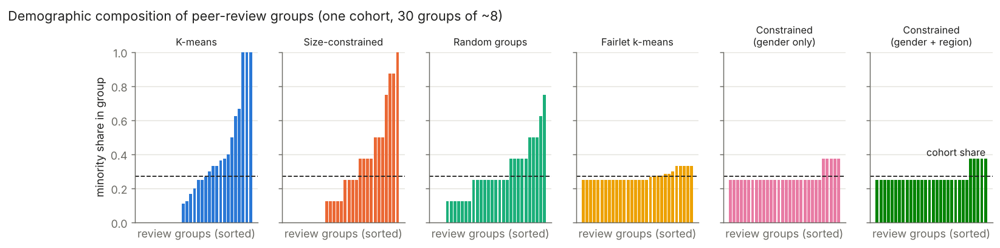
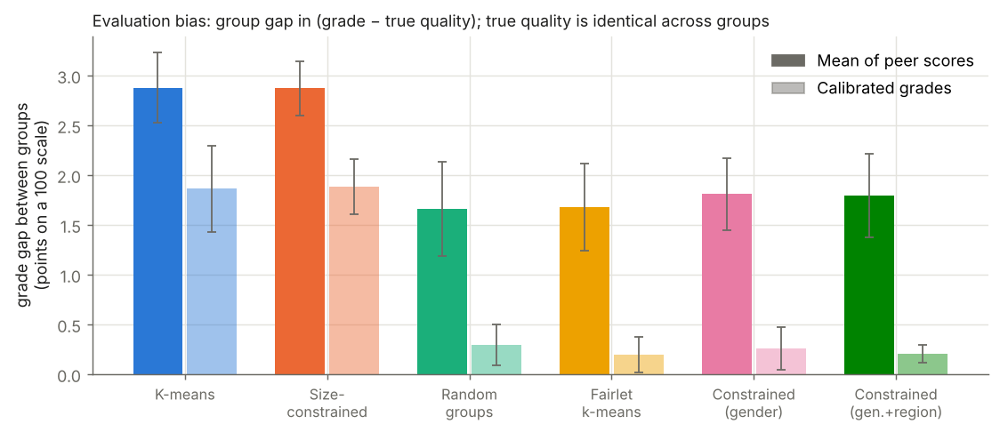
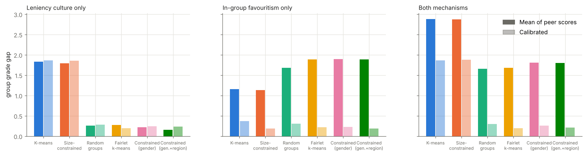
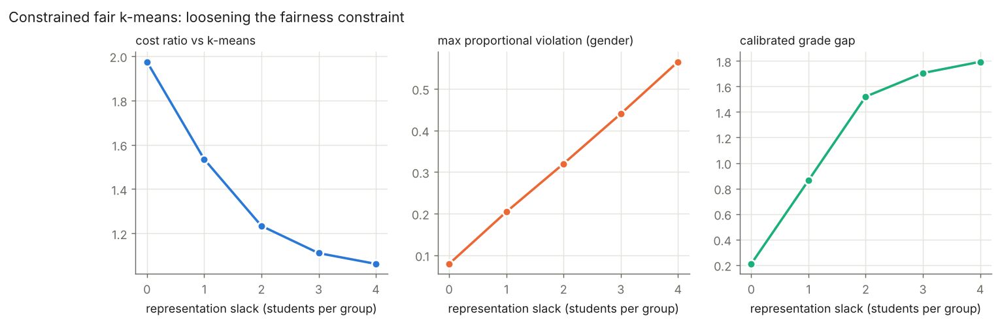
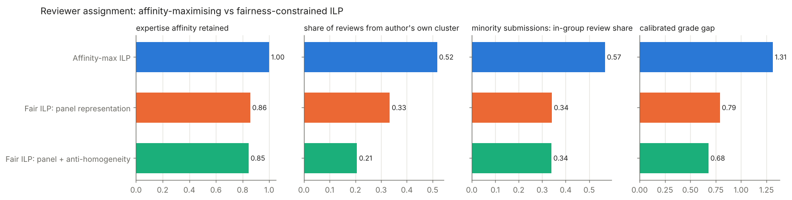

# Fairness-Aware Clustering for Peer Evaluation Systems

Design and evaluation of fairness-aware clustering algorithms for **student peer-review groups** and **reviewer assignment**, mitigating demographic bias with **fair k-means (fairlet decomposition)** and **constraint-based (ILP) methods**. The project enforces balanced representation of sensitive attributes in every group and panel, and measures how much this reduces homogeneity-driven bias in evaluation outcomes.

```
fair-peer-clustering/
├── fairpeer/                  # library
│   ├── data.py                # synthetic cohort generator + CSV loader for real data
│   ├── clustering.py          # K-means, Random, Fairlet k-means, Constrained fair k-means
│   ├── assignment.py          # reviewer assignment ILP (affinity-max vs fair)
│   ├── simulation.py          # biased peer-review model, mean & calibrated grade aggregation
│   ├── metrics.py             # balance, proportional violation, entropy, cost, outcome bias
│   └── _solver.py             # LP-relaxation + exact integer repair (HiGHS)
├── experiments/run_experiments.py   # E1–E4, writes results/ and figures/
├── examples/quickstart.py
├── tests/test_fairpeer.py     # 14 tests: constraint guarantees, metrics, calibration
├── results/                   # CSVs + summary.md (generated)
└── figures/                   # fig1–fig6 (generated)
```

## Quick start

```bash
pip install -r requirements.txt
python examples/quickstart.py                 # 5-second demo
python -m pytest -q                           # 14 tests
python experiments/run_experiments.py         # full study, ~3 min (use --quick for ~1 min)
```

## 1. Problem

Peer evaluation systems usually group students by **similarity** (shared topic, skill profile) so reviewers understand the work. When features correlate with demographics, similarity grouping produces **demographically homogeneous groups**. Two bias mechanisms then distort grades:

| Mechanism | Model | Effect of homogeneous groups |
|---|---|---|
| **Local grading culture** (homogeneity-driven) | each reviewer's leniency varies smoothly in feature space, so a similarity cluster shares one harshness level | a whole cluster's grades shift together; because clusters align with demographics, one group is systematically under-graded |
| **In-group favouritism** | +δ points when reviewer and author share a group (δ = 4 for gender, 1.5 for region) | depends on how many in-group reviewers each author receives |

The score reviewer *i* gives submission *j* is

  s<sub>ij</sub> = q<sub>j</sub> + leniency<sub>i</sub> + δ·[g<sub>i</sub> = g<sub>j</sub>] + δ<sub>r</sub>·[region<sub>i</sub> = region<sub>j</sub>] + ε,  ε ~ N(0, 4²).

True quality q is drawn **independently of every sensitive attribute**, so any group difference in (grade − q) is pure evaluation bias. The synthetic cohort has 240 students, a binary attribute (`gender`, 30% minority) and a three-valued attribute (`region`), with group-correlated features.

## 2. Methods

### Peer-review groups (clustering)

| Method | Idea | Fairness guarantee |
|---|---|---|
| **K-means** | Lloyd's algorithm on features (baseline) | none |
| **Size-constrained** | constrained k-means with equal sizes, no fairness (ablation) | none |
| **Random groups** | equal-size random partition | in expectation only |
| **Fairlet k-means** (Chierichetti et al., 2017) | decompose points into *fairlets* of 1 minority + t or t+1 majority points by an exact min-cost assignment (Hungarian algorithm), then weighted k-means on fairlet centres | every cluster has balance ≥ 1/(t+1); binary attribute only |
| **Constrained fair k-means** (Bera et al., 2019 style) | Lloyd iterations whose assignment step is a 0/1 program: each cluster holds between ⌊n<sub>v</sub>/k⌋−s and ⌈n<sub>v</sub>/k⌉+s members of **every value of every** sensitive attribute, and cluster sizes are equal | exact, for several attributes at once; slack *s* tunes the fairness/coherence trade-off |

The constrained assignment is solved by LP relaxation, fixing integral variables and solving the small remaining integer program exactly (`fairpeer/_solver.py`) — sub-second per iteration versus minutes for a cold MILP. Integer count bounds are used instead of fractional share bounds because review groups are small (8 students), where fractional bounds are either vacuous or infeasible.

### Reviewer assignment (ILP)

Each student reviews r = 4 submissions and receives 4 reviews; no self-review; equal load.

* **Affinity-max ILP** – maximise total cosine expertise affinity (common practice).
* **Fair ILP: panel representation** – adds ⌊r·p<sub>v</sub>⌋ ≤ #reviewers from group v ≤ ⌈r·p<sub>v</sub>⌉ for every submission, attribute and value.
* **Fair ILP: panel + anti-homogeneity** – additionally at most one reviewer from the author's own similarity cluster.

### Grade aggregation

* **Mean** of received scores.
* **Calibrated**: least-squares fit of s<sub>ij</sub> = q<sub>j</sub> + b<sub>i</sub> + δ·same<sub>ij</sub> (ridge on reviewer effects b). Reviewer leniency and favouritism are **only identifiable when groups/panels are mixed**; in homogeneous groups they are confounded with quality.

## 3. Results

10 seeds for clustering, 5 for assignment; mean ± std. Full tables: `results/summary.md`.

### E1 — Peer-review groups

| Method | Balance (gender) ↑ | Balance (region) ↑ | Cost ratio ↓ | Raw gap ↓ | Calibrated gap ↓ | Top-20% DI ratio ↑ |
|---|---|---|---|---|---|---|
| K-means | 0.00 | 0.00 | 1.00 | 2.88 ± 0.34 | 1.86 ± 0.41 | 0.72 |
| Size-constrained | 0.00 | 0.00 | 1.05 | 2.87 ± 0.26 | 1.88 ± 0.26 | 0.68 |
| Random groups | 0.00 | 0.00 | 3.31 | 1.66 ± 0.45 | 0.30 ± 0.19 | 0.83 |
| Fairlet k-means | 0.34 | 0.00 | 1.39 | 1.68 ± 0.41 | **0.20 ± 0.17** | 0.80 |
| Constrained (gender) | 0.31 | 0.00 | **1.32** | 1.81 ± 0.34 | 0.26 ± 0.20 | 0.76 |
| Constrained (gender + region) | 0.31 | **0.65** | 1.97 | 1.80 ± 0.40 | 0.21 ± 0.08 | 0.79 |

*Balance* = min over groups of minority/majority count ratio (0 means some group has no member of a demographic). *Gap* = difference between groups in mean (grade − true quality), on a 100-point scale. *DI ratio* = selection-rate ratio for the top 20%.




### E2 — Which bias does fairness fix?

| Raw gap | Leniency culture only | Favouritism only | Both |
|---|---|---|---|
| K-means | 1.83 | 1.16 | 2.88 |
| Constrained (gender + region) | **0.16** | 1.89 | 1.80 |

| Calibrated gap | Leniency culture only | Favouritism only | Both |
|---|---|---|---|
| K-means | 1.86 | 0.37 | 1.86 |
| Constrained (gender + region) | 0.23 | 0.19 | **0.21** |



### E3 — Fairness / coherence trade-off (constrained, gender + region)

| Slack (students) | 0 | 1 | 2 | 3 | 4 |
|---|---|---|---|---|---|
| Cost ratio | 1.98 | 1.54 | 1.23 | 1.11 | 1.06 |
| Max proportional violation (gender) | 0.08 | 0.20 | 0.32 | 0.44 | 0.57 |
| Calibrated gap | **0.21** | 0.86 | 1.52 | 1.71 | 1.79 |



### E4 — Reviewer assignment

| Configuration | Affinity retained | Panel violation ↓ | Same-cluster share ↓ | Raw gap | Calibrated gap ↓ |
|---|---|---|---|---|---|
| Affinity-max ILP | 1.00 | 0.26 | 0.52 | 3.04 | 1.31 ± 0.27 |
| Fair: panel representation | 0.86 | 0.06 | 0.33 | 3.21 | 0.79 ± 0.36 |
| Fair: panel + anti-homogeneity | 0.85 | 0.06 | **0.21** | 3.05 | **0.68 ± 0.50** |



## 4. Findings

1. **Similarity grouping is segregating.** In k-means groups the dominant gender makes up 84% of a group on average (cohort share: 70%); some groups contain no minority student at all, others are 100% minority (fig. 1).
2. **Fair clustering removes homogeneity-driven bias directly.** Under the local-grading-culture mechanism, constrained fair k-means cuts the raw grade gap from 1.83 to 0.16 points (−91%), without any change to how grades are computed.
3. **Representation alone does not remove favouritism — and can increase the raw gap.** Under pure in-group favouritism, balanced groups give minority authors fewer in-group reviewers than majority authors (a 30% group cannot supply 70% of anyone's panel), so the raw gap rises from 1.16 to 1.89. This is a structural property, not a tuning issue: equal in-group exposure across unequal-size groups is infeasible under equal reviewer load.
4. **Balanced groups make bias correctable.** Because mixed groups decouple reviewer effects from author quality, calibrated aggregation brings the gap to ≈0.2 points under every regime, whereas with k-means groups calibration leaves 1.86 points (−89% overall vs k-means calibrated; −93% vs k-means raw).
5. **Cost of fairness is moderate and controllable.** Gender-only fairness costs 1.32–1.39× the k-means objective; adding region raises it to 1.97×. The slack parameter traces the full trade-off (E3); slack 0 is needed for the calibration benefit.
6. **Fair reviewer assignment keeps 85% of expertise affinity** while cutting panel representation violation from 0.26 to 0.06 and same-cluster reviews from 52% to 21%, roughly halving the calibrated gap (1.31 → 0.68).
7. **Random groups are not a fair alternative** for small groups: they still produce groups with no minority member (balance 0) and cost 3.3× the k-means objective in topical coherence.

## 5. Using real data

```python
from fairpeer import load_cohort_csv, ConstrainedFairKMeans
cohort = load_cohort_csv("students.csv", feature_cols=["topic_1", "topic_2", "gpa"],
                         sensitive_cols=["gender", "first_gen"])
labels = ConstrainedFairKMeans(n_clusters=25).fit_predict(cohort.X, cohort.sensitive)
```

For real data without ground-truth quality, report the cluster-fairness metrics and compare calibrated vs raw grades; outcome metrics that need `quality` are skipped.

## 6. Limitations

* Results are on **synthetic** data with a specified bias model; magnitudes depend on δ and leniency strength. The code is built to run the same study on a real cohort.
* Fairlet decomposition is implemented for one binary attribute; the constrained method handles multi-valued and multiple attributes.
* The fair reviewer ILP solves in 2–35 s for n = 240; larger cohorts may need the LP relaxation alone or a min-cost-flow special case.
* Group-level fairness metrics do not address individual fairness or intersectional subgroups beyond the attributes constrained.

## References

* Chierichetti, Kumar, Lattanzi, Vassilvitskii. *Fair Clustering Through Fairlets.* NeurIPS 2017.
* Bera, Chakrabarty, Flores, Negahbani. *Fair Algorithms for Clustering.* NeurIPS 2019.
* Backurs et al. *Scalable Fair Clustering.* ICML 2019.
* Stelmakh, Shah, Singh. *PeerReview4All: Fair and Accurate Reviewer Assignment in Peer Review.* JMLR 2021.
* Piech et al. *Tuned Models of Peer Assessment in MOOCs.* EDM 2013 (reviewer bias calibration).
